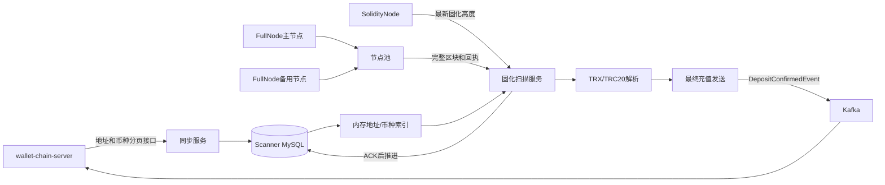

# TRON扫描器详细设计

## 1. 设计目标

`wallet-tron-scanner` 是独立的 TRON 链数据采集服务，负责：

1. 从 `wallet-chain-server` 同步需要永久监控的平台地址和可充值币种。
2. 将地址保存为本地索引并加载到内存。
3. 以 SolidityNode 最新固化高度为上界，通过 FullNode 顺序读取完整区块和回执。
4. 解析进入平台充值地址的 TRX 和 TRC20 转账。
5. 向 Kafka 可靠发送 `DepositConfirmedEvent`。
6. 在 Kafka ACK 后保存扫描检查点，服务重启后继续扫描。

Scanner 不保存用户账户、充值业务单或私钥，不构造和签署交易。

## 2. 核心结论

### 2.1 独立部署

每条链保留独立扫描器：

```text
wallet-tron-scanner
wallet-bsc-scanner
wallet-eth-scanner
```

链特有的节点协议、扫块任务和交易解析留在扫描器。`wallet-chain-server` 管理统一地址、币种和业务订单。

### 2.2 独立数据库

Scanner 使用独立 schema 和数据库账号，只保存：

- `tron_monitor_address`：平台监控地址副本。
- `tron_scan_checkpoint`：最后完整处理的固化区块。

地址和币种从 Chain Server 同步，最终充值通过 Kafka 发送。Scanner 不直接访问 Chain Server 数据库。

### 2.3 固化后再扫描

Scanner 不扫描未固化 Head 区块。处理范围为：

```text
本地检查点 + 1  ～  SolidityNode最新固化高度
```

因此不需要保存最近区块历史、查找共同祖先或自动回退，也不需要 Chain Server 再次执行充值确认。

## 3. 总体架构



### 3.1 Chain Server职责

- 管理币种配置、平台地址和用户绑定。
- 提供 Scanner 地址、币种同步接口和监控水位 ACK。
- 幂等消费最终充值事件。
- 原子创建已确认充值并累计待归集金额。
- 通知出入金服务完成入账。

### 3.2 Scanner职责

- 保存和加载监控地址本地副本。
- 管理 TRON 节点健康与主备切换。
- 读取固化边界内的区块和回执。
- 校验检查点和区块连续性。
- 解析充值并等待 Kafka ACK。
- 保存最后完整成功的固化区块。

## 4. 本地数据库

### 4.1 `tron_monitor_address`

```sql
CREATE TABLE `tron_monitor_address` (
    `source_address_id` BIGINT NOT NULL COMMENT 'chain_address.id，也是增量同步游标',
    `chain_network` VARCHAR(32) CHARACTER SET ascii COLLATE ascii_bin NOT NULL COMMENT 'TRON网络',
    `address` VARCHAR(64) CHARACTER SET ascii COLLATE ascii_bin NOT NULL COMMENT 'Base58Check地址',
    `address_purpose` VARCHAR(32) CHARACTER SET ascii COLLATE ascii_bin NOT NULL COMMENT '地址用途',
    `created_at` DATETIME(3) NOT NULL DEFAULT CURRENT_TIMESTAMP(3),
    PRIMARY KEY (`source_address_id`),
    UNIQUE KEY `uk_tron_monitor_address` (`chain_network`, `address`),
    KEY `idx_tron_monitor_address_sync` (`chain_network`, `source_address_id`)
) ENGINE=InnoDB DEFAULT CHARSET=utf8mb4 COLLATE=utf8mb4_unicode_ci;
```

扫描器永久保留已同步地址。地址后来被停用或换出，也可能继续收到链上资产，不能停止监控。

### 4.2 `tron_scan_checkpoint`

```sql
CREATE TABLE `tron_scan_checkpoint` (
    `chain_network` VARCHAR(32) CHARACTER SET ascii COLLATE ascii_bin NOT NULL,
    `last_block_number` BIGINT NOT NULL COMMENT '最后完整处理的固化区块高度',
    `last_block_hash` VARCHAR(128) CHARACTER SET ascii COLLATE ascii_bin NOT NULL COMMENT '最后完整处理的固化区块Hash',
    `updated_at` DATETIME(3) NOT NULL DEFAULT CURRENT_TIMESTAMP(3) ON UPDATE CURRENT_TIMESTAMP(3),
    PRIMARY KEY (`chain_network`)
) ENGINE=InnoDB DEFAULT CHARSET=utf8mb4 COLLATE=utf8mb4_unicode_ci;
```

首版一个实例、一个扫描任务、每个网络一条检查点。每完成一个区块，使用一条更新语句同时保存高度和 Hash。

## 5. 地址与币种同步

### 5.1 内存索引

```text
TRON address → AddressPurpose
TronAsset    → TronCurrencyConfig
```

地址使用 `ConcurrentHashMap`。启动时先从本地表完整构建新 Map，再一次性替换；索引未就绪时禁止扫块。

### 5.2 增量地址同步

```text
读取本地最大source_address_id
→ 按afterId从Chain Server分页拉取
→ 本地事务保存一页地址
→ 更新内存索引
→ 更新内存应用水位
→ ACK应用水位
→ 拉取下一页
```

相同 ID 和地址完全一致视为幂等成功；相同 ID 对应不同地址或相同地址对应不同 ID 时停止同步。

### 5.3 币种快照

启动和定时任务从 Chain Server 读取当前 TRON 币种，完整转换成功后一次性替换内存快照。TRC20 合约地址使用 TRON Base58Check 规范，不做大小写转换。

## 6. 节点读取

### 6.1 节点分工

- SolidityNode：查询最新固化高度。
- FullNode：读取完整区块、交易回执和指定高度区块头。
- FullNode备用节点：主节点失败时在备用节点上完整重读。

同一区块的区块体、回执和最后 Hash 复核必须来自同一个 FullNode，禁止混用不同节点的数据。

### 6.2 节点入口

```text
TronNodeManager
├─ getSolidHeight()
├─ getBlockHeaderByHeight(height)
└─ getBlockDataByHeight(height)
```

业务代码不感知节点 URL、API Key 和主备节点编号。详细契约见 [阶段4：TRON节点能力契约](阶段4-TRON节点能力契约.md)。

## 7. 固化区块扫描

### 7.1 首次初始化

生产必须明确配置 `start-block-height`。数据库没有检查点时：

```text
initialHeight = start-block-height - 1
→ 读取initialHeight的区块Hash
→ 保存初始检查点
→ 从start-block-height开始扫描
```

`start-block-height = 0` 时保存 `-1 / 空Hash` 哨兵，不请求负数高度。

### 7.2 每轮扫描

```text
1. 确认地址和币种索引已就绪
2. 加载检查点H / Hash-H
3. 重新读取H并复核Hash-H
4. 查询最新固化高度S
5. end = min(S, H + max-blocks-per-run)
6. 顺序处理H+1到end
```

例如已扫到 1000、固化到 1250、单轮上限 100，本轮只扫描 1001～1100。

### 7.3 单区块处理

```text
读取H+1完整区块和回执
→ 校验高度为H+1、parentBlockId等于Hash-H
→ 解析TRX/TRC20充值
→ 有充值时发送Kafka并等待全部ACK
→ 更新检查点为H+1 / Hash-(H+1)
```

空区块不发送消息，但仍推进检查点。区块内任何交易解析失败时整块失败，不发送部分结果。

### 7.4 连续性异常

固化区块按协议不应变化。以下情况统一抛出 `SOLIDIFIED_SCAN_CHAIN_INVALID(916003)`：

- 数据库检查点 Hash 与节点同高度 Hash 不一致。
- 节点返回高度不是期望的下一高度。
- 新区块父 Hash 接不上检查点 Hash。

处理结果固定为：记录 ERROR、停止本轮、保留检查点、不自动回退，等待人工核查节点、网络和数据库。

完整流程和故障矩阵见 [阶段6：TRON固化充值扫描闭环](阶段6-充值发现闭环设计.md)。

## 8. 交易解析

### 8.1 TRX

只处理成功的 `TransferContract`：

- 读取付款地址、收款地址和 SUN 整数金额。
- 收款地址必须是平台 `DEPOSIT` 地址。
- 原生币配置必须存在。
- `eventIndex` 固定为 `-1`。

### 8.2 TRC20

只处理成功回执中的 `Transfer(address,address,uint256)` 日志：

- Topic0 必须是标准 Transfer 事件签名。
- 日志合约必须存在于币种配置。
- 从 Topic1、Topic2 和 Data 解析付款方、收款方和数量。
- 收款地址必须是平台 `DEPOSIT` 地址。
- 使用日志原始序号作为 `eventIndex`。

### 8.3 幂等键

```text
chainCode + txId + eventIndex
```

Scanner 使用 `BigInteger` 保存链上最小单位金额，不换算展示金额。详细规则见 [阶段5：TRON交易解析设计](阶段5-TRON交易解析设计.md)。

## 9. Kafka最终充值事件

```text
Topic: ChainKafkaTopics.DEPOSIT_CONFIRMED_TOPIC
Key:   chainCode
Value: DepositConfirmedEvent
```

一个固化区块最多每 300 笔充值拆成一条消息。处理顺序为：

```text
全部消息获得Broker ACK
→ 更新本地区块检查点
```

任一消息失败都不推进检查点。ACK 已成功但检查点更新失败时，下轮会重发整块消息；Chain Server 依靠充值唯一键幂等处理。

## 10. 故障恢复

| 故障 | 结果 |
|---|---|
| 查询固化高度失败 | 本轮停止，检查点不变 |
| FullNode读取失败 | 节点池切换备用节点并整组重读；全部失败则停止 |
| 区块或回执协议错误 | 当前区块失败，检查点不变 |
| 充值解析失败 | 整块失败，检查点不变 |
| Kafka ACK失败或超时 | 检查点不变，下轮重发 |
| 检查点更新失败 | 检查点保持旧值，下轮重发 |
| 固化链证据不连续 | ERROR 916003，停止并人工核查 |
| 服务重启 | 从数据库检查点复核后继续 |

## 11. 并发与幂等

- XXL-JOB 固定一个执行器串行触发扫描任务。
- 地址和币种索引完整替换，扫块只读取稳定快照。
- 每块完成后立即推进检查点，不使用长数据库事务。
- Kafka 使用至少一次投递语义，Chain Server 使用唯一键去重。
- Scanner 不使用分布式锁，也不支持多个实例同时推进同一网络检查点。

## 12. 最小配置

```yaml
nb:
  tron:
    scanner:
      chain-network: ${TRON_NETWORK:MAINNET}
      start-block-height: ${TRON_SCAN_START_BLOCK_HEIGHT}
      max-blocks-per-run: 100
      expected-genesis-block-id: ${TRON_GENESIS_BLOCK_ID}
      node:
        connect-timeout: 3s
        read-timeout: 10s
        max-response-size: 16MB
        health-check-interval: 15s
        failure-threshold: 3
        height-lag-threshold: 20
        recovery-cooldown: 60s
        nodes:
          - code: full-primary
            role: FULL_NODE
            priority: 1
            base-url: ${TRON_FULL_NODE_PRIMARY_URL:}
            api-key: ${TRON_FULL_NODE_PRIMARY_API_KEY:}
          - code: full-backup
            role: FULL_NODE
            priority: 2
            base-url: ${TRON_FULL_NODE_BACKUP_URL:}
            api-key: ${TRON_FULL_NODE_BACKUP_API_KEY:}
          - code: solidity-primary
            role: SOLIDITY_NODE
            priority: 1
            base-url: ${TRON_SOLIDITY_NODE_URL:}
            api-key: ${TRON_SOLIDITY_NODE_API_KEY:}
```

生产必须提供起始高度、创世区块 ID 和节点地址。FullNode 与 SolidityNode 必须属于同一网络。

## 13. 代码入口

| 顺序 | 类 | 职责 |
|---:|---|---|
| 1 | `HeadBlockScanJob` | 定时触发 |
| 2 | `HeadBlockScanService` | 扫描编排 |
| 3 | `HeadBlockContinuityService` | 固化链连续性校验 |
| 4 | `TronNodeManager` | 节点读取与统计 |
| 5 | `DepositDiscoveryService` | 充值解析与地址匹配 |
| 6 | `DepositConfirmedPublisher` | 最终事件发送和ACK等待 |
| 7 | `HeadScanProgressService` | 检查点初始化与推进 |

节点协议、地址转换和通用交易解析集中在 `wallet-tron-sdk`。Scanner 通过依赖 JAR 使用；源码联调显式启用 `-PuseLocalTronSdk=true`。

## 14. 可观测性

至少记录：

- 当前检查点和本轮固化边界。
- 本轮成功区块数与剩余落后区块数。
- 节点读取、Kafka ACK 和检查点提交耗时。
- 节点切换与全部节点不可用。
- 固化链异常的期望高度、实际高度、期望父 Hash、实际父 Hash和节点编码。

日志不得包含节点 API Key、第三方完整响应或任何签名材料。

## 15. 验收标准

1. Scanner 绝不读取固化高度之后的充值区块。
2. 重启后从最后成功检查点继续，不重复扫描全部历史。
3. 读取、解析、发送或提交任一步失败都不会越过当前区块。
4. Kafka ACK 成功后才允许推进检查点。
5. 重复发送不会让 Chain Server 重复入账。
6. 检查点 Hash、高度或父 Hash 异常时输出明确 ERROR 并保持检查点。
7. FullNode 主节点失败后可在备用节点完整重读。
8. Scanner 数据库不保存用户绑定、充值业务单、私钥和 `key_ref`。
9. 100万地址规模下内存查询保持常数时间。

验收测试和图解见 [阶段6：TRON固化充值扫描闭环](阶段6-充值发现闭环设计.md) 与 [TRON固化充值扫描闭环图解](学习笔记/04-TRON固化充值扫描闭环图解.md)。

## 16. 首版不实现

- 未固化交易或 Pending Pool 扫描。
- Event Plugin 实时订阅。
- Scanner Outbox 和本地充值订单表。
- Redis 或 Bloom Filter 地址匹配。
- 全量区块、交易和回执归档。
- 固化链异常自动回退。
- 多实例主动抢占同一网络检查点。
