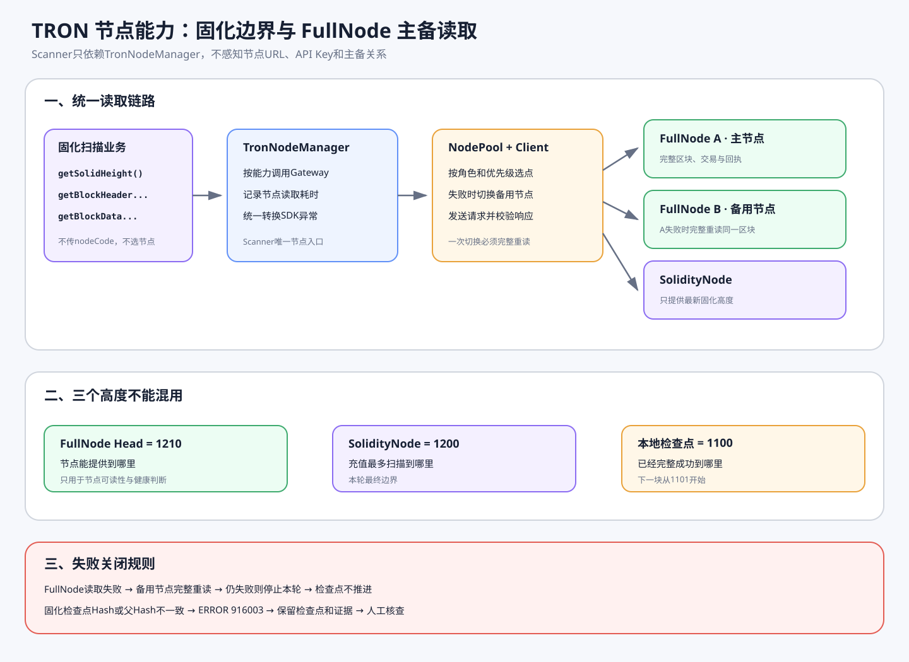

# TRON节点能力图解

这张图说明 Scanner 如何用 SolidityNode 确定固化边界，再由 FullNode 主备节点读取完整区块。



## 一、三个组件的职责

- `TronNodeManager`：Scanner 唯一节点入口，提供固化高度、区块头和完整区块读取。
- `TronNodePool`：按节点角色、健康状态、高度和优先级选择节点，失败时选择备用节点。
- `TronNodeClient`：向已选节点发送一次 HTTP 请求并校验响应，不选节点、不重试。

```text
getSolidHeight()                    查询本轮固化扫描上界
getBlockHeaderByHeight(height)      复核数据库检查点
getBlockDataByHeight(height)        读取完整区块、交易和回执
```

## 二、FullNode与SolidityNode

### FullNode

- 提供完整区块、交易和回执。
- 同一区块的区块体、回执和 Hash 复核固定在同一个节点完成。
- 主节点失败时，备用节点必须从头完整重读该区块。

### SolidityNode

- 只返回最新固化高度。
- 决定 Scanner 本轮最多扫描到哪里。
- 不替代 FullNode 提供完整交易解析数据。

## 三、主备切换

1. A、B 都健康时持续使用优先级更高的 A。
2. A 当前请求失败时，A 进入冷却，本次在 B 上完整重读。
3. 冷却期间继续使用 B，避免节点反复切换。
4. A 持续健康达到恢复观察时间后，才允许重新成为主节点。
5. 所有候选节点失败时结束本轮，检查点保持不变。

## 四、三个高度

| 高度 | 作用 |
|---|---|
| FullNode Head高度 | 判断节点是否已同步到待读取高度，不决定充值扫描边界 |
| SolidityNode固化高度 | 本轮允许扫描的最高区块 |
| 本地检查点高度 | Scanner最后完整处理并获得Kafka ACK的固化区块 |

例如 FullNode 到 1210、SolidityNode 固化到 1200、本地检查点为 1100，Scanner 本轮只能在 1101～1200 内扫描。

## 五、安全规则

```text
节点读取失败
→ 在一个备用FullNode上完整重读
→ 仍失败则结束本轮
→ 不返回空区块或伪造高度
→ 不推进tron_scan_checkpoint
```

检查点 Hash 或下一块父 Hash 不一致时不切换逻辑继续猜测，也不自动回退；Scanner 输出 `ERROR 916003` 并等待人工核查固化链证据。
