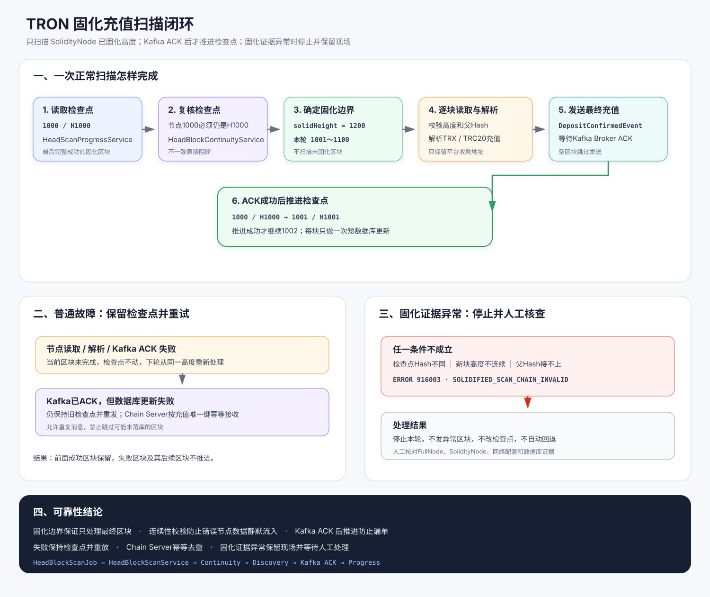

# TRON固化充值扫描闭环图解

这张图说明 Scanner 如何从固化边界顺序扫描、可靠发送最终充值，以及各类故障发生后检查点如何处理。

## 一、正常扫描

假设检查点是 `1000 / H1000`，SolidityNode 已固化到 `1200`，单轮最多扫描 100 块：

1. `HeadBlockScanService` 先读取 1000 的区块头，确认仍为 `H1000`。
2. 本轮范围固定为 `1001～1100`，不读取 1201 之后的未固化区块。
3. 1001 必须满足 `height=1001` 且 `parentBlockId=H1000`。
4. 解析进入平台地址的 TRX / TRC20 充值。
5. 有充值时发送 `DepositConfirmedEvent` 并等待 Kafka ACK。
6. ACK 成功后把检查点推进到 `1001 / H1001`，然后处理 1002。

空区块不发送消息，连续性校验通过后仍推进检查点。

## 二、为什么发送失败后会重发

如果 Kafka 未 ACK，Scanner 保持旧检查点；下轮仍从当前区块开始。

如果 Kafka 已 ACK，但数据库更新失败，Scanner 同样保持旧检查点并重发。Chain Server 使用充值唯一键幂等接收，因此重复消息不会重复入账。

## 三、固化链异常怎么处理

出现以下任一情况时，Scanner 输出 `ERROR 916003` 并停止：

- 检查点高度的节点 Hash 与数据库 Hash 不同。
- 新区块高度不是检查点高度加一。
- 新区块父 Hash 不能接上检查点 Hash。

固化区块按协议不应变化，因此系统不会自动回退检查点。运维需要核对 FullNode、SolidityNode、网络配置和数据库记录，确认原因后再恢复任务。

## 四、从哪里看代码

| 顺序 | 代码入口 | 作用 |
|---:|---|---|
| 1 | `HeadBlockScanJob` | 定时触发扫描 |
| 2 | `HeadBlockScanService.scanBlocks()` | 组织完整扫描流程 |
| 3 | `HeadBlockContinuityService` | 复核检查点与新区块连续性 |
| 4 | `DepositDiscoveryService` | 解析 TRX / TRC20 充值 |
| 5 | `DepositConfirmedPublisher` | 发送最终充值并等待 ACK |
| 6 | `HeadScanProgressService.advance()` | 保存最后成功区块 |

详细故障矩阵见 [阶段6：TRON固化充值扫描闭环](../阶段6-充值发现闭环设计.md#6-故障恢复矩阵)。
